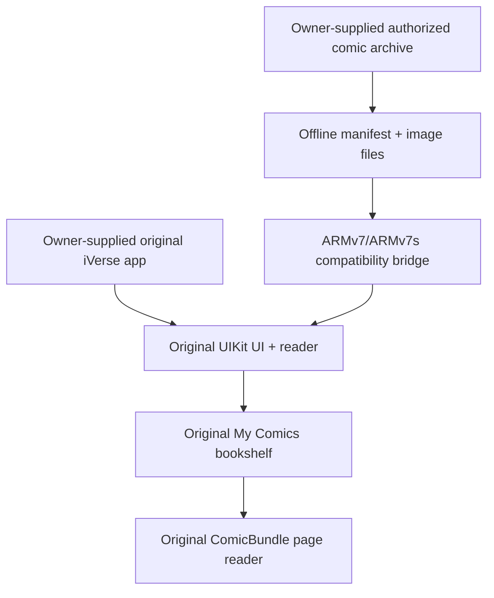

# Pocket God Comics — Legacy Reader Preservation

> **An unofficial preservation and compatibility project for the classic Pocket God Comics reading experience.**  
> Original iVerse-style reading interface · Offline comic library · iPhone & iPad · Legacy iOS


**The mission:** preserve the look, navigation and page-turning experience of the original iVerse-based Pocket God Comics app on older Apple hardware. This project explores offline comic access while keeping the **real iPhone and iPad reader interfaces**, rather than replacing them with a generic web viewer.

**This public repository contains original compatibility code and project documentation.** It does **not** distribute the proprietary iVerse app, Pocket God Comics story pages, original artwork, IPA binaries or other third-party media. Current test builds with bundled media remain in a separate private repository, pending redistribution-rights review.

---

## ✨ Two editions — one app per library

| Feature | Classic 25 | Complete 63 |
|---|---|---|
| Library | 25 WEBTOON entries | 63 WEBTOON entries |
| Cleaned reading pages | 269 | 702 |
| Covers | 25 original printed cover images, **provisionally matched** to entries | Those 25 covers plus 38 individually created covers |
| User interface | Original iVerse iPhone/iPad reader | Original iVerse iPhone/iPad reader |
| Reading | Offline, for content already packaged locally | Offline, for content already packaged locally |
| Status | Built; awaiting hardware QA | Built; awaiting hardware QA |

> **Numbering clarification:** Classic 25 currently means the **first 25 WEBTOON episodes** with authentic printed-issue covers mapped to the shelf slots. It is **not yet** a reconstruction of all 25 original *printed issues*. The distinction is tracked in the roadmap rather than hidden.

## 📱 Hardware and OS targets

The v13 universal QA packages include **armv7 and armv7s** code in both the original executable and compatibility bridge, and declare support for **iPhone and iPad** with **iOS 7.0 minimum**.

| Device | Target iOS versions | Test status |
|---|---|---|
| iPhone 4 | iOS 7–7.1.2 | Pending physical QA |
| iPhone 4S | iOS 7–9 | Pending physical QA |
| iPhone 5 / 5c | iOS 7–9 | Pending physical QA |
| iPad 2 / 3 / 4 | iOS 7–9 | Pending physical QA |
| iPad mini (1st generation) | iOS 7–9 | Pending physical QA |

Some 64-bit devices running iOS 7–9 can run 32-bit apps, but they have **not** been independently certified by this project. iOS 6 and older, ARMv6, and modern 64-bit-only iOS are not targets of these binaries.

[Full compatibility notes](docs/COMPATIBILITY.md)

## 🧩 How preservation works



The original reader stays in place. An Objective-C bridge supplies offline entries through the existing **Core Data** catalog and **ComicBundle** page interfaces. There are **separate phone and tablet shelf controllers**, both handled in the combined build. Small JPEG shelf thumbnails reduce memory pressure on older devices.

**Startup safety:** Earlier v11 builds automatically presented *My Comics* on launch and were reported to crash on an iPad. v12 rolled that behavior back. The v13 universal test builds **preserve the original startup screen**; testers open My Comics manually.

[Architecture](docs/ARCHITECTURE.md) · [Building](docs/BUILDING.md) · [Troubleshooting](docs/TROUBLESHOOTING.md)

## 🧪 State of the project

- [x] Inspect original phone/tablet application paths
- [x] Prepare 25 and 63 offline libraries
- [x] Preserve 269 and 702 cleaned reading pages in local test packages
- [x] Integrate original print covers and 38 separately generated covers into private packages
- [x] Bridge both iPhone and iPad My Comics shelves to the original reader
- [x] Build **two** packages including armv7 and armv7s
- [x] Remove automatic shelf startup after reported crashes
- [x] Verify IPA structure, content bytes, cover mapping and bundle metadata
- [ ] Verify reliable operation on physical iPhone 4 / 4S and iPad hardware
- [ ] Reconstruct the actual 25 original printed volumes, not merely the first 25 episodes
- [ ] Publish reproducible, hardware-tested release procedures
- [ ] Explore modern iOS and Android editions as separate work

**Compile success and ZIP validation are not substitutes for hardware compatibility testing.** These editions are QA builds, not certified stable releases.

## 🔎 Repository contents

```text
src/PGOfflineLoader.m      Original Objective-C compatibility bridge
tools/inspect_ipa.py       Read-only local IPA/manifest inspection
tools/verify_cover_set.py  Validates individually numbered cover images
docs/ARCHITECTURE.md       Original-reader integration and design
docs/COMPATIBILITY.md      iOS and device targeting
docs/INSTALLATION.md       Preflight, backups, manual library navigation
docs/BUILDING.md           Build prerequisites and source boundaries
docs/TESTING.md            Physical device QA checklist
docs/TROUBLESHOOTING.md    Known regressions and diagnostic steps
docs/ROADMAP.md            Milestones and future work
docs/PROVENANCE.md         Copyright, source and asset policy
```

The public source is intentionally **not** a download mirror for proprietary app/comic content. A complete local build requires your own legitimate originals and a properly configured compatible toolchain.

## 🛠 Quick inspection

Inspect an IPA that you own and are permitted to use:

```bash
python3 tools/inspect_ipa.py /path/to/your-test.ipa
```

Validate an individually numbered set of cover files:

```bash
python3 -m pip install -r requirements-dev.txt
python3 tools/verify_cover_set.py /path/to/covers --start 26 --end 63
```

These tools work on your local files; they do not download books or commercial binaries.

## 📋 Help test the original reader

Back up your existing app and data container before installation. Test cold launch, open My Comics **manually**, check count/order/covers, read first and last books, page forward/back, return to shelf and repeat after restarting.

Use the [device bug report](.github/ISSUE_TEMPLATE/bug_report.yml) with **hardware model, iOS version, edition and reproducible steps**. Never attach proprietary IPA files, comic pages, passwords, SSH keys or unredacted personal logs.

[Testing checklist](docs/TESTING.md) · [Contributing](CONTRIBUTING.md) · [Security](SECURITY.md)

---

### Rights, attribution and licensing

**Unofficial, unaffiliated preservation work.** Pocket God, Pocket God Comics, iVerse, related characters, comic stories, trademarks, commercial applications and original art belong to their respective rights holders. This repository does not grant redistribution rights for any third-party materials. A personal offline archive does not itself authorize public redistribution.

The project-specific compatibility code is visible for review; **no explicit open-source reuse license has yet been selected**. Public repository visibility is not a license grant. See [Provenance and rights](docs/PROVENANCE.md).

*Preserve the story. Preserve the reader. Document what actually works.*
